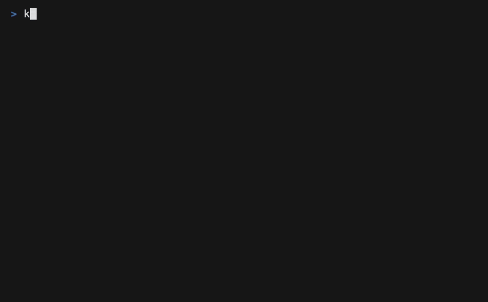
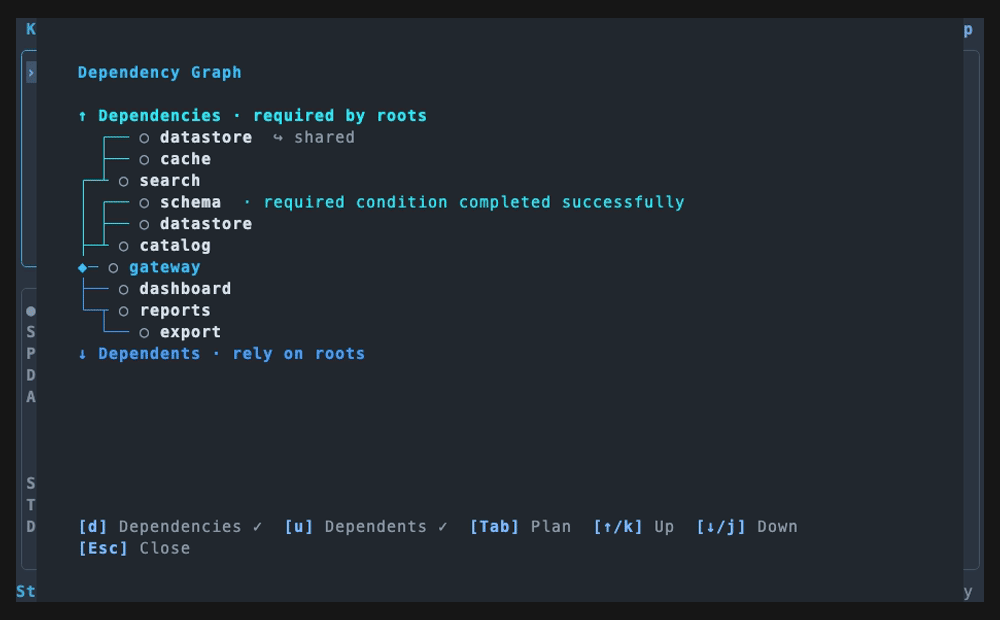

# TUI: the terminal interface

Running `kranz` opens the keyboard-first TUI. It is an operator view over the
same runtime used by the CLI and MCP, so a command or coding agent can inspect
the stack without opening a second copy.

<div class="demo-frame">



</div>

## What is on screen

| Area | What it shows | Focus key |
| --- | --- | --- |
| Services / Tags | Services, dependencies, actions, groups, tags, selection, and lifecycle state | `1` |
| Details | The focused item's command, health, dependencies, ports, and current operation | `2` |
| Logs | Captured service, action, and lifecycle output with follow, wrap, timestamps, and regex search | `3` |

The header summarizes the runtime and active work. The footer shows the most
relevant keys for the current focus. Press `?` at any time for in-application
help.

## Read state at a glance

The dot beside a service is its lifecycle state, not a health verdict:

| Indicator | Meaning |
| --- | --- |
| Green | The process or detached resource is running |
| Gray | It is stopped |
| Yellow | A start, stop, dependency wait, or lifecycle operation is in progress |
| Red | It failed or exited unsuccessfully |

Readiness and liveness are separate. Details names the configured probes and
their latest result; a missing probe is shown as not configured, never as a
successful health check. Runtime-discovered ports and the PID that owns them
appear in the same panel.

The focused row controls what Details and Logs show. Checked rows are the
targets for batch lifecycle shortcuts such as `s`, `Shift+S`, and `Shift+R`.
The `r` shortcut always starts from the focused service.

## A first session

1. Use `↑` / `↓` or `j` / `k` to focus a service.
2. Press `Space` to select it, or `a` to select all services.
3. Press `s` to start the selection and its dependencies.
4. Press `2` to inspect readiness, liveness, dependencies, and ports.
5. Press `3` to follow logs; press `/` to search them.
6. Return to panel `1` and press `s` again to review and confirm the stop plan.

Actions appear below their service or project group. Focus an action and press
`s` to run it. Its output is multiplexed into the Logs panel and labeled with
the exact `OWNER/ACTION#run` identity.

## Review lifecycle plans

Starting a service with `s` includes its transitive dependencies. Stopping it
with `s` includes its dependents in reverse order. Use `Shift+S` to start or
stop only the selected targets, or the focused target when there is no selection.

For example, if `api` depends on `db` and both are active, focus `db` and press
`r` to review restarting both services. With an empty selection, `Shift+R`
on `db` restarts just `db`. When services are checked, `Shift+R` restarts
only the checked services and starts any checked services that are stopped.

To select a service and everything it needs, focus it and press `Shift+A`.
Press it again to clear the selection when that exact set is already checked.
Moving the cursor leaves the selection in place until you press `Shift+A` on
another service or change the selection manually.

To expand several selections at once, mark the services with `Space`, then
press `Shift+E`. It adds every direct and transitive dependency as an individual
service mark. A tag selection expands into individual marks as well. When all
the marked services are running, `Shift+S` stops that exact set.

Use `Ctrl+R` to confirm a restart of all active services and `Ctrl+A` to
confirm a stop of all services. For the full list, press `?` in the TUI or
see the [controls reference](../reference/controls#lifecycle-and-actions).

## Inspect dependencies and preview an operation

Press `g` to open the dependency tree for the checked service, or for the
focused service when no services are checked. When several services are
checked, `g` opens the operation steps. Press `Tab` to switch between the
graph and steps.



The focused service sits in the center, with its dependencies above and its
dependents below. When several services are checked, the graph puts those
services together in the center and identifies shared relationships. Press
`d` or `u` to hide or show either direction independently. The graph shows
live service states and observed probe results. The two directions use arrow
labels and nearby shades of the active theme accent. The dependency branch
leans slightly warmer and the dependent branch slightly cooler. A state marker
appears before each name. A hollow circle marks a stopped service, and its
last exit code appears when available.

The plan uses the checked services, including selections made through tags.
With no selection, it uses the focused service. In either view, press
`←` or `→` to cycle through operations, or use `s`, `x`, and `r` to choose
Start, Stop, and Restart. The chosen operation stays selected when you switch
views. Press the shortcut for the selected operation to show its confirmation
control in either view.

The plan shows the requested services and the resulting steps in order. A
dependency-aware start groups services into numbered readiness waves, with
colors that move between the graph's two theme-derived colors. Numbered
steps use the same progression. Limited palettes can collapse nearby shades
to the same color. The numbers remain visible at every terminal color depth.
The plan draws direct dependency links between services in each phase. Press
`f` to preview acting only on the targets, as with the shifted lifecycle
shortcuts. A selected-only start puts checked dependencies before their
consumers and skips readiness gates. Restart skips stopped targets. Use
Start to launch stopped services.

From Graph or Steps, press `Enter` or click the button below the operation
selector to run the highlighted operation. The current view stays open and
shows progress and the result. Select an operation again to clear the result
and review the next run. Scroll the current view with the up and down arrows
or the mouse wheel. Press `Esc` to dismiss confirmation or close the viewer.

The example walks through a shared dependency and a live health probe.
[Dependency viewer example](../examples/dependency-viewer)

## Work with logs

Panel `3` follows the focused service by default. `Shift+3` pins it while you
move elsewhere. Search with `/`, then use `Tab` to switch between filtering and
highlighting; `n` and `Shift+N` move between highlighted matches. Toggle wrap
with `w`, captured-at timestamps with `i`, and following with `f`.

`WRAP` and `TIME` appear in the log header when enabled. The panel keeps its
selected row while output arrives, including wrapped, filtered, and pinned
views.

Service output survives a crash or stop for as long as the runtime exists.
Every service start and action execution has a run number, so logs remain
attributable across restarts instead of becoming one ambiguous stream.

## Actions, history, and notifications

Actions live below their service or project action group. Run a focused action
with `s`; confirmation is shown when its configuration requests it. Completed
actions remain available by their `OWNER/ACTION#run` identity, including their
captured output and exit status.

Press `c` on a parameterized action to open its form. When radio or checkbox
choices exceed the available width, the form puts every choice on its own
aligned line; long labels wrap without hiding options.

Press `n` outside an active log-highlight search to open notifications. Press
`h` from Logs for recorded health transitions. Both views explain what changed
without requiring you to reconstruct it from raw output.

## Attach to a background runtime

`kranz up -d` starts a runtime and returns the shell. Open the same runtime in
the TUI later with:

```bash
kranz attach
```

Every TUI is attached to an independently owned runtime, including the one
opened by bare `kranz`. The quit confirmation always shows
which managed processes and configured detached resources will stop and which
external resources will remain active. Confirm shutdown with `Enter` or `y`,
press `d` to detach the TUI and keep the complete runtime running, or press `c`
for **Close & choose**: stop this runtime and immediately choose another in the
same TUI process. Use `Esc` or `n` to stay.

The [CLI workflow](./cli-workflow) and [MCP guide](./mcp) operate the same live
runtime. A restart from either is reflected immediately in this TUI.

## Switch between local runtimes

One TUI can work with several projects. Press `p` to list local runtimes,
with the current runtime first. Press `Enter` on another compatible runtime
to attach, or on the current runtime to close the list. `Esc` also closes it.

On another runtime, press `s` to review the same shutdown plan shown by the
quit confirmation, then confirm stopping it without attaching. The TUI stays
open on the current runtime. The current row has no `s` action; use `q` to
review its shutdown choices. A runtime with an incompatible protocol cannot
be attached, but it can be stopped after confirmation. That confirmation
shows verified managed processes and warns that detached resources may remain
running because their stop plan is unavailable.

Runtime and Run history tables adapt to the terminal width. Wide terminals
show their complete detail; narrower ones remove secondary columns first and
wrap shortcut groups onto additional footer rows, keeping the selection and
close controls visible without horizontal clipping.

Each runtime you visit keeps its own selection, log filters, pinned log, and
scroll position for as long as this TUI process runs, so returning to one
looks exactly as you left it. Switching never stops, restarts, or otherwise
touches the runtime you are leaving: an operation it already accepted keeps
running, and you see its result if you switch back before it finishes.

Starting `kranz` outside a project directory behaves the same way it always
has once one is found. Without one, if any local runtime is already running,
the same list opens immediately instead of failing; if none is, Kranz prints
an error and exits.

If the runtime the dashboard is currently showing stops — the process
crashed, or was stopped from elsewhere — the TUI shows a recovery screen
instead of closing, offering `r` to restart that project or `c` to choose
another running one. See the [switching runtimes
reference](../reference/controls#switching-runtimes) for the complete key
list, row states, and recovery behavior.

**Close & choose** uses this same live list after intentionally stopping the
current runtime. An empty list is a normal state; `q` exits and `Esc` returns to
the recovery actions.

## Common keys

| Key | Meaning |
| --- | --- |
| `1`, `2`, `3` | Focus Services/Tags, Details, or Logs |
| `Tab`, `Shift+Tab` | Move between panels |
| `Enter` | Expand or collapse the focused row |
| `Space` | Select or unselect a service or tag |
| `s` | Start, stop with confirmation, or run a focused action |
| `r` | Start the focused service or confirm its restart with active dependents |
| `Shift+R` | Start or restart just the selected targets |
| `Shift+A` | Select or clear the focused service and its dependencies |
| `Shift+E` | Add the dependencies of all selected services to the selection |
| `Ctrl+A` | Confirm stop of all services |
| `Ctrl+R` | Confirm restart of all active services |
| `/` | Search logs with a regular expression |
| `x` | Toggle Combined/Single run logs |
| `[` / `]` | Move to the previous/next run |
| `v` | Open run history; filter and select with keyboard or mouse |
| `e` / `Ctrl+E` | Export the selected run to clipboard / a chosen file |
| `p` | Switch to another local Kranz runtime |
| `m` | Open the configuration map |
| `Ctrl+T` | Open the theme and appearance picker |
| `Ctrl+L` | Reload configuration |
| `?` | Open help |
| `q` | Open the quit confirmation |

The [complete controls reference](../reference/controls) covers selection
overrides, log navigation, health history, notifications, shell handoff, mouse
interaction, and shutdown behavior. The guides for [actions](./actions),
[lifecycle](./lifecycle), [logs, runs, and ports](./logs-and-ports), and
[appearance](./appearance) include focused recordings of those workflows.

## Copy a fragment

Focus a log panel with `3`. Drag over a URL or error, or press `y` to select the
last visible logical line. Extend a keyboard selection with `Shift+Up/Down`.
You can also start dragging in empty space to the right of or below the text.
Press `Enter` to copy selected text.
Click outside the selection to clear it; `Shift`-click extends it.
Outside selection mode, `[c] Clear` opens the log-clearing confirmation.
While text is selected, `c` does nothing; press `Esc` to leave selection first.
For example, selecting these messages yields exactly:

```text
Connection refused
    at connect (client.js:42)
```

Clean text retains indentation, tabs and application timestamps. It excludes
terminal controls, generated prefixes, borders and padding. Soft wraps do not
add line breaks, and no final newline is added. `a` selects only visible viewport
text; `Shift+A` selects the whole frozen snapshot, including offscreen text.
Both commands are shown in the selection footer and can be clicked.
Full-line keyboard selection includes the entire logical line.

The active panel shows **SELECT · frozen** with line/byte counts. Selected text
uses a theme accent fill that contrasts with the canvas, including near-white
custom backgrounds; its text color is chosen separately for readability. Its bounded
snapshot stays stable during incoming logs, retention eviction, resize and wrap
changes. Filters omit hidden records; highlight includes intermediate records.
The snapshot budget is 1 MiB of readable text and metadata or 20,000 logical
lines. Larger views are refused as a whole: choose a run or narrow the filter.
Select all covers retained logs for the current panel, run and filter; it does
not retrieve evicted history or include logs arriving after selection started.
A bounded “New logs” indicator reports incoming data without claiming a count.

Copy preserves selection for retry. `Esc` restores the previous follow/pause or
nearest retained browsing position. Changing panels, target/run/runtime or search
ends selection. After disconnect or source removal, captured text remains
available for copying; Done returns to normal recovery.

See [selection controls](../reference/controls#select-and-copy-log-fragments)
and [clipboard troubleshooting](./troubleshooting#nothing-pasted-from-the-tui).
